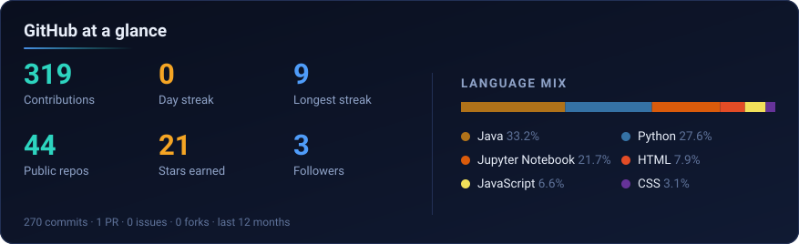

  <picture>
    <source media="(prefers-reduced-motion: reduce)" srcset="https://raw.githubusercontent.com/ShubhParmar112/ShubhParmar112/main/assets/hero-static.svg">
    
  </picture>

  
  
  
  
  

 

### 01 · About

I'm a Data Science undergraduate at **NMIMS MPSTME, Mumbai**, and most of what I build sits where machine learning has to survive contact with a real system: a model is the easy half, and serving it, testing it, monitoring it and being honest about where it fails is the other half.

Three published papers so far — one on a refinement to the mid-point circle algorithm, one on a transportation-optimisation method, one on the Bitcoin ecosystem. Alongside those I've interned at **RE Journal** and **InlighnX Global**. My capstone — a three-factor biometric ATM — is finished; beyond it I work on agentic systems and local language models, and on what you can pull out of audio with a neural network.

### 02 · Research & recognition

**Publications.**

- *Refinement of the Existing Mid-Point Circle Generating Algorithm.* IEEE. [Read the paper ↗](https://ieeexplore.ieee.org/document/10932192) · [Implementation](https://github.com/ShubhParmar112/Mid-Point-Circle-Generating-Algorithm)
- *Middle Man's Path: A Novel Transportation Optimization Approach.* IEEE. [Read the paper ↗](https://ieeexplore.ieee.org/document/11294751) · [Implementation](https://github.com/ShubhParmar112/The-Middle-Man-s-Path--OM-Research-)
- *A Compendium of the Latest Erudite Analyses of the Shifting Intricacies Within the Bitcoin Ecosystem.* International Journal of Environmental Sciences. [Read the paper ↗](https://theaspd.com/index.php/ijes/article/view/4713)

**Also.**

- [LogisticsNow AI Hackathon](https://github.com/ShubhParmar112/LogisticsNow-AI-Hackthon-Certificate) — participant; the work became [ConvoyX](https://github.com/ShubhParmar112/Lorri-LogisticNow-ConvoyX)
- [GDG Hackathon](https://github.com/ShubhParmar112/AgriGPT_GDG-Hackathon) — built AgriGPT
- [MPSTME SIH Buildathon](https://github.com/ShubhParmar112/MPSTME-SIH-Buildathon)

### 03 · Selected projects

#### [NorvyX — Multi-Modal Biometric Authentication for ATM Security](https://github.com/ShubhParmar112/Multi-Modal-Biometric-System_Capstone-Project) · *capstone*

`InsightFace / ArcFace` `MediaPipe` `ESP32 / R307S` `SQLite` `FastAPI` `CustomTkinter`

My capstone: an ATM that asks for three independent proofs before it opens. A face scan identifies you against 512-d L2-normalised ArcFace embeddings (InsightFace `buffalo_l`, ONNX Runtime on CPU), a blink check over MediaPipe's 478-landmark mesh rules out a photograph, a fingerprint read over UART from an R307S sensor on an ESP32 verifies the finger, and a fusion engine refuses to continue unless face and fingerprint name the *same* person — then the PIN. It runs fully offline against SQLite with an audit log, and carries a banker console, a web banking app, ML fraud detection over transaction features, and a portfolio advisor.

[Repository](https://github.com/ShubhParmar112/Multi-Modal-Biometric-System_Capstone-Project)

#### [M.I.K.E.Y — Multimodal Intelligent Knowledge & Execution Engine for You](https://github.com/ShubhParmar112/M.I.K.E.Y)

`Python` `Ollama` `local LLMs` `uv` `pytest`

A personal AI cognitive operating system: an append-only event log, a policy-gated executor sandbox, long-term memory and durable missions, under a decomposed multi-brain orchestration layer. It is deliberately **keyless** — every answer comes from a model running on your own machine, and no API key is read even if one is set in the environment. 486 tests passing.

[Repository](https://github.com/ShubhParmar112/M.I.K.E.Y) · [Architecture docs](https://github.com/ShubhParmar112/M.I.K.E.Y/tree/master/docs)

#### [Material Classification using CNN](https://github.com/ShubhParmar112/German-Project)

`TensorFlow` `mel-spectrogram CNN` `librosa` `Django`

Strike a piece of metal and it tells you what it is. A CNN trained on mel-spectrograms identifies the material from the sound alone, wrapped in a Django app whose `/analyze` endpoint takes an audio upload and returns the prediction together with the feature analysis behind it, so the charts show *why* rather than only *what*.

[Repository](https://github.com/ShubhParmar112/German-Project) · [Earlier deployment](https://github.com/ShubhParmar112/FOML_Deployment)

#### Speech Emotion Recognition using Deep Learning

`MLP classifier` `RAVDESS` `MANOVA / ANOVA` `audio features`

*Evaluating Emotional Speech Accents Through MLP Classifier and Multivariate Statistical Analysis.* Emotion classification over the RAVDESS dataset plus custom recordings, with the statistics taken seriously: MANOVA, ANOVA and t-tests to establish which acoustic features actually carry emotion before the neural models classify it, then a comparison of how emotional expression shifts across accents.

[Project page ↗](https://shubhparmar112.github.io/)

#### [Exploring Agentic AI & LLM Applications](https://github.com/ShubhParmar112/Prodigal_Agent)

`Groq` `Streamlit` `agent tools` `validation guards`

An ongoing thread of work on agents that hold a goal across a conversation. The clearest artifact so far is **Prodigal Agent**: it takes one candidate ID, works out what their application is missing, collects it in a natural conversation, validates it, writes it back safely and records how the conversation ended — including when the candidate simply goes quiet. A terminal chat and a web chat drive the same core; 48 checks cover the validators, the evidence guard and message cleanup.

[Repository](https://github.com/ShubhParmar112/Prodigal_Agent)

#### [Train Reservation System](https://github.com/ShubhParmar112/Train-Reservation-System)

`C++` `trees` `queues`

A console reservation system where the data structures do the work: cabins and seats live in a tree that updates as the train is reconfigured, and the waitlist is a queue that reallocates seats first-come-first-served the moment a booking is cancelled.

[Repository](https://github.com/ShubhParmar112/Train-Reservation-System)

#### [Tic-Tac-Toe](https://github.com/ShubhParmar112/Tic_Tac_Toe-using-pygame-)

`Python` `Pygame`

A playable Tic-Tac-Toe built with Pygame — small, finished, and the kind of thing worth keeping around.

[Repository](https://github.com/ShubhParmar112/Tic_Tac_Toe-using-pygame-)

<b>Everything else</b> — the NLP engine, the MLOps pipeline, hackathon builds and coursework

 

| Project | What it is |
| :-- | :-- |
| [Student Feedback Intelligence](https://github.com/ShubhParmar112/SNLP_Proj) | Aspect-based sentiment over student feedback, served as an API · tuple-F1 0.704 against a 0.452 TF-IDF baseline |
| [Diabetes Prediction — MLOps](https://github.com/ShubhParmar112/devops-N-mlops_Proj) | The full lifecycle: MLflow, pytest, CI/CD to Docker Hub, Minikube, Prometheus & Grafana |
| [AgriGPT](https://github.com/ShubhParmar112/AgriGPT_GDG-Hackathon) | Crop recommendation from a neural model, wrapped in a Django app · GDG Hackathon |
| [QAOA Portfolio Optimizer](https://github.com/ShubhParmar112/Portfolio-Optimizer-using-QAOA-Quantum-Comp-Proj-) | Portfolio selection posed as a QUBO and solved with the Quantum Approximate Optimization Algorithm |
| [ConvoyX](https://github.com/ShubhParmar112/Lorri-LogisticNow-ConvoyX) | Logistics routing built for the LogisticsNow AI hackathon |
| [Real-Time Ride Matching](https://github.com/ShubhParmar112/Real-Time-Ride-Matching-System) | Matching riders to drivers under live constraints |
| [HarvestHub](https://github.com/ShubhParmar112/HarvestHub) · [AppDev](https://github.com/ShubhParmar112/AppDev_HarvestHub) | Farm-to-market platform, web and Android with Firebase auth |
| [TSA on Whale Movement](https://github.com/ShubhParmar112/TSA-on-Whale-Movement) | Time-series analysis of migration data |
| [Madhav E-Comm](https://github.com/ShubhParmar112/Madhav-EComm-Store-Analytics--Power-BI-) · [SkyGrow](https://github.com/ShubhParmar112/SkyGrow-EComm-Dashboard--Tableau-) | Retail analytics dashboards in Power BI and Tableau |
| [The Lunar Cradle](https://github.com/ShubhParmar112/The-Lunar-Cradle-DBMS) | Hotel management database: guests, bookings, payments, staff and services |
| [Shush](https://github.com/ShubhParmar112/Shush) | Mental-health commerce and content site with its own design system |
| [FusionHub](https://github.com/ShubhParmar112/FusionHub) | Responsive restaurant site for global fusion cuisine |

### 04 · Toolkit

| | |
| :-- | :-- |
| **Focus** | Machine learning · Deep learning · Computer vision · NLP · Generative & agentic AI |
| **Languages** | Python · C++ · Java · SQL · JavaScript |
| **Deep learning** | PyTorch · TensorFlow · Keras · scikit-learn · Transformers · OpenCV |
| **Language models** | LLM fine-tuning · RAG · agent tooling · Hugging Face · Ollama · Groq |
| **Data** | NumPy · Pandas · Matplotlib · Seaborn · Power BI · Tableau |
| **Shipping** | Django · FastAPI · Streamlit · Docker · Kubernetes · MLflow · GitHub Actions · Prometheus & Grafana |

### 05 · Contributions

  

Same year, animated

 

  <picture>
    <source media="(prefers-color-scheme: dark)" srcset="https://raw.githubusercontent.com/ShubhParmar112/ShubhParmar112/output/snake-dark.svg">
    <source media="(prefers-color-scheme: light)" srcset="https://raw.githubusercontent.com/ShubhParmar112/ShubhParmar112/output/snake.svg">
    
  </picture>

### 06 · GitHub at a glance

  

Both cards are generated by this repo's own <a href=".github/workflows/profile.yml">workflow</a> from the GitHub GraphQL API and refreshed daily. Public activity only.

 

Open to internships and collaboration in applied ML, NLP and MLOps.

  

